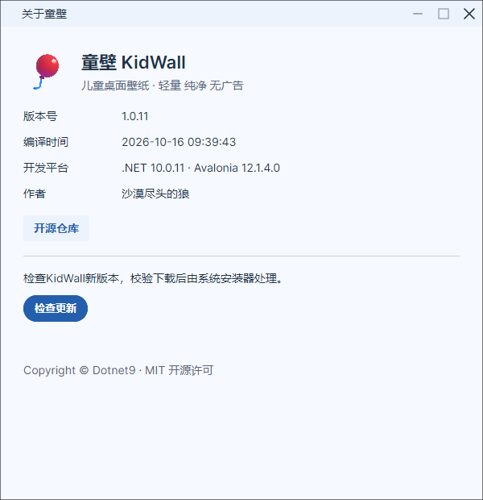

# 原型与实现验收

## 1.0.11 当前复核（2026-10-16）

本轮使用 CodeWF.Avalonia `12.1.4.25`，Toolkit 保持 `1.0.0.19`。primary-btn 与设置按钮改用 Semi 实心按钮；预览按钮保留遮罩底色和白字的模板配对，修复悬停后出现浅底白字的问题。

正式 Windows x64 发布脚本通过仓外快照执行，只重定向产物、中间目录和开发 NuGet 配置，保留原编译与裁剪参数；NativeAOT 产物、正式 EXE 的 `--verify-runtime` 与原生 UI 验证器均通过。实际界面完成 283 项成功检查；新增回归通过真实模板和鼠标事件覆盖八色 × 明暗下的 normal、hover、pressed、恢复状态，共 192 次文字对比测量，最低 4.8498:1，另验证禁用按钮拒绝输入及重新启用后的色值恢复。

Core 8 项测试通过。单文件生成一致性检查通过，浏览器完整审计通过：双语、三态、八色、关于与更新流程。原型真实按钮的三态配色审计另有 48 次测量，最低 4.8498:1。

本次 README 关键静态 PNG 来自该版本的 NativeAOT 界面验证器。下方保留历史验证记录，版本号、旧安装包哈希及历史 GIF 不能作为本轮新安装器验收结果。当前未执行真实安装、普通桌面拖放或多显示器操作；Linux/macOS 产品运行由各平台继续验收。

## 历史验证记录

2026-10-16，版本 1.0.10：补充真实窗口绑定下从 `Task.Run` 直接切换全局语言的用例，复现并修复外观模型访问主题资源的跨线程异常。通知返回 UI 线程后刷新主题和绑定集合，模型释放后忽略排队回调；使用同一个已创建的语言菜单切回原语言。验证始终使用隔离偏好、静态图库及壁纸服务替身，不注册开机启动、不设置系统壁纸。视频封面生成使用应用缓存，当前静态用例不执行该路径，因此不能将静态回归概括成视频写入隔离验证。

1.0.10 已使用官方 NuGet 源及独立缓存，通过正式发布脚本、正式 EXE 隔离运行自检、PE 无 CLR 目录检查及完整 NativeAOT 界面回归；Windows 安装器已生成并核对 SHA-256，未实际安装。图库浅深色及双语关于窗口的关键截图逐张检查，README 与本页截图已更新为本版原生结果。原型浏览器审计及单文件生成一致性检查通过。

2026-10-16，版本 1.0.9 补充：修复全局语言切换与第三方主题接线。验证器直接修改唯一 I18nManager，在同一个已打开的 Semi TextBox 上反复展开实际菜单，检查中英文复制、粘贴文案及 Ursa 对话框资源；宿主设置同键文案后继续回切，覆盖保持生效。主题字典保存在主题自身资源中，事件切换在 UI 线程执行。

2026-10-15，版本 1.0.8。原型位于 `design/index.html`，产品使用 Semi、Ursa 与 CodeWF 控件体系。以相同的 1280 × 820 窗口核对标题栏、分类、四列图库、设置和关于窗口；不会用构建成功代替界面验收，也不把截图数量折算成还原百分比。

## 已验证

- 核心测试 8 项通过。偏好、壁纸目录均使用源生成 JSON。
- 实际界面 269 条断言，覆盖真实控件绑定、持久化、动态切语与更新状态；Windows NativeAOT 使用同一套断言运行。
- 收藏与本地目录使用稳定标识写入偏好，覆盖刷新、重复目录规范化、重启恢复、移除收藏后的即时过滤及计数通知；增加收藏与本地分类。原型同步收藏、唯一当前壁纸、跨刷新状态和翻译后的分类搜索。
- 标题栏只保留八个配色点、Ursa 三态主题按钮及 Semi 语言菜单，设置页去掉重复外观入口；实际点击 Ursa 内部按钮并通过真实 ListBox 验证选择与持久化。
- 实际展开语言菜单并执行菜单项；Ursa 内部按钮的三态工具提示绑定宿主 T4 资源，跟随中英切换即时刷新。
- 真实 XAML 离屏回归覆盖八套配色的浅深模式，另验证系统模式、模式与配色独立保存、搜索、预览、收藏和当前卡片动态切语。
- 关于窗口保持打开时切换中英，校验实际程序集版本、编译时间和平台。受控服务验证检查、失败、下载后安装入口、取消和关闭取消；不启动真实安装器。
- 静态图库使用仓库 12 张真实图片及隔离偏好。浅深两种模式下检查所有可见徽标，装饰光效不能产生“动态壁纸”徽标。
- 浏览器审计覆盖两语言、三种主题模式、八套配色、关于、受控更新状态和脚本异常；原型与应用 JSON 由脚本保持同步。色点使用共享主题的固定色样与排列顺序，Aurora 保留渐变。
- 原型主窗的最小化和关闭均提供恢复入口，最大化实际改变布局宽度；About 最小化、最大化与实际窗体一致禁用，关闭后可重新打开。
- Windows 仓库发布脚本及原生离屏验证分别执行。使用隔离目录及壁纸替身，验收不会设置用户的桌面壁纸。

```powershell
dotnet test --project tests/KidWall.Core.Tests/KidWall.Core.Tests.csproj -c Release
pwsh scripts/sync_localization_keys.ps1 -Check
dotnet run --project scripts/ui-verification/UiVerification.csproj -c Release -- artifacts/ui-verification
npm ci --prefix design/tests
# 首次在 design/tests 中运行 npx playwright install chromium
npm test --prefix design/tests
pwsh scripts/publish.ps1 -RuntimeIdentifier win-x64
dotnet publish scripts/ui-verification/UiVerification.csproj -c Release -r win-x64 -p:PublishAot=true -p:IlcGenerateCompleteTypeMetadata=true -p:IlcTrimMetadata=false -p:IlcSingleThreaded=true -o artifacts/native-ui
./artifacts/native-ui/UiVerification.exe artifacts/native-ui-captures
```

## 对照与差异

| 检查点 | 实现及原型状态 |
| --- | --- |
| 标题栏、搜索、分类、卡片 | 保留同一功能层级，60 px 标题栏、1240 px 内容上限、20 px 卡片间距；平台窗口按钮使用 CodeWFWindow |
| 配色及语言 | 同源八色令牌、三种独立模式、中英文选择，宿主资源输出，库资源内嵌 |
| 设置与关于 | 独立关于窗口；未实现的省电和内容过滤均明确禁用 |
| 动态徽标 | 只由壁纸媒体类型决定；静态卡片的星光等装饰效果不会显示动态徽标 |
| 图库内容 | 原型有 16 个示例；产品加载仓库及用户选定目录；回归图库有 12 张静态图。条目数量和动态媒体不能按截图等同 |
| 更新 | 原型仅模拟状态；产品使用 Toolkit 的实际检查、下载和安装服务 |

2026-10-15 逐图对照采用中文、.NET 深色、1280 × 820，并将原型限制为同样的 12 张静态样例、4 项推荐、无收藏和当前壁纸。两侧均为四列、20 px 间距、约 158 px 卡片高度，分类字体 14 px。原型首卡约 (48, 195)、281 px 宽，原生约 (50, 199)、280 px 宽；原型节标题 20 px、原生 19 px，浏览器阴影和选中辉光略强。页脚已直接绑定宿主现有的 `Main.Footer.Text`，两语切换均有审计，避免保留与产品不同的“开源原型”文案。



当前尚不能宣称达到全页面 95% 还原：真实视频播放器、浮层过渡的逐帧视觉、多 DPI、键鼠及输入法尚未逐项桌面验收。锁屏期间使用真实控件离屏渲染；未重新操作实际桌面或执行真实安装。Linux/macOS 运行、Windows 壁纸设置和 VLC 动态桌面仍需对应环境与用户数据下的专项验收。原生编译存在依赖库的裁剪和 AOT 分析警告，已通过路径不代表全部反射分支。

本轮最终原生验收使用共享控件与国际化包 `12.1.4.22`：正式 Windows x64 NativeAOT 发布、269 条实际界面断言均通过，关于窗口的最小化和最大化按能力禁用。本页及 README 的 PNG 来自最终 NativeAOT 验证器。Windows EXE 安装包已编译并生成 SHA-256；签名/DMG 失败传播、五平台安装包与 SHA-256 门禁的正反例已验证，实际安装器交互未执行。

后续门禁复查固定本产品、完整版本、架构与安装格式的准确文件名，避免把 `1.2.3.4` 误判为 `1.2.3`。受控文件验证完整产物通过，错误产品、错误版本、额外压缩包、篡改校验、缺失安装器或校验文件、空安装器均被拒绝；不重复执行已通过的正式 NativeAOT，也不移动已公开标签。

正式程序支持 --verify-runtime <独立目录>，只读取输出双语 JSON，检查全局语言回切，并在新建隔离子目录保存和恢复偏好。该分支在 Avalonia、窗口及壁纸服务初始化前运行；Windows 发布流程在生成安装器前执行它。

1.0.9 补充验证已使用官方 NuGet 的独立缓存完成：正式发布脚本、正式 EXE 隔离自检、PE 原生检查、同源码 NativeAOT 离屏交互与本机 EXE 安装器。README 图库截图由本轮原生验证器重新生成；没有执行真实安装或设置系统壁纸。
